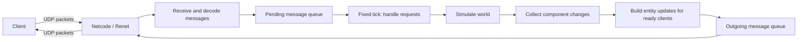
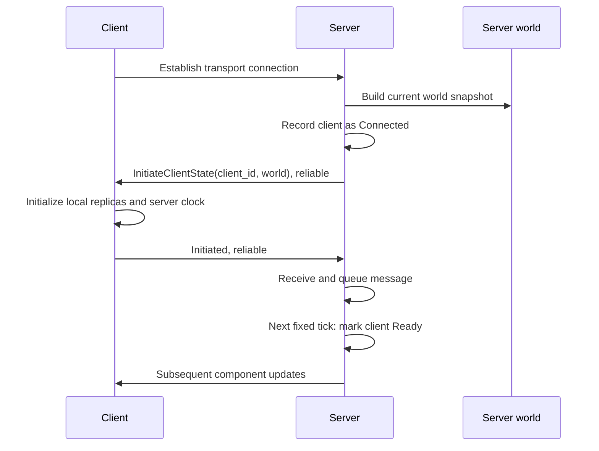

# Server-side workflow

This guide explains the server implemented in this repository, from process startup to sending world updates to clients. It describes the current code, including unfinished behavior, rather than a proposed architecture.

## 1. What the server does

The server owns an in-memory game world. It moves entities, changes their health, and sends their state to connected clients. Clients receive an initial copy of the world and then smaller updates as components change.

The main technologies are:

| Technology | Responsibility |
| --- | --- |
| Rust | Implementation language |
| Bevy ECS | Stores entities and components and schedules systems |
| Bevy fixed schedules | Runs simulation at the configured tick rate |
| Renet | Provides message queues and reliable/unreliable channels |
| Netcode transport | Handles connections and transports packets over UDP |
| Serde + Postcard | Converts messages and components to/from binary bytes |

There is no HTTP API, database, or persistent world storage in this implementation. Restarting the process creates a fresh world.



Connection initialization is an exception to the outgoing application queue: it sends its initial snapshot directly through Renet.

## 2. Code map

Paths below are relative to the repository root.

| File | What to look for |
| --- | --- |
| [main.rs](crates/server/src/main.rs) | Creates the app, installs plugins, starts the server |
| [config.rs](crates/server/src/config.rs) | Reads environment variables |
| [server.rs](crates/server/src/server.rs) | Opens the socket and installs server resources and systems |
| [messages.rs](crates/server/src/messages.rs) | Receives requests, advances ticks, dispatches handlers, sends responses |
| [handlers.rs](crates/server/src/handlers.rs) | Handles ping requests |
| [client.rs](crates/server/src/client.rs) | Tracks connections and initialization state |
| [world.rs](crates/server/src/world.rs) | Builds a complete world snapshot |
| [entity.rs](crates/server/src/entity.rs) | Assigns network IDs and announces entity creation/removal |
| [simulation.rs](crates/server/src/simulation.rs) | Movement, boundary bouncing, and health changes |
| [replication.rs](crates/server/src/replication.rs) | Converts collected changes into outgoing entity updates |
| [test_scenes/](crates/server/src/test_scenes/mod.rs) | Selects and creates the initial demo scene |
| [shared/lib.rs](crates/shared/src/lib.rs) | Shared app initialization and component registration |
| [shared/replication.rs](crates/shared/src/replication.rs) | Component registry, change collection, ID mapping, delivery rules |
| [shared/snapshots.rs](crates/shared/src/snapshots.rs) | Network identity and snapshot structures |
| [shared/components.rs](crates/shared/src/components.rs) | Position, health, and ownership definitions |
| [shared/client_messages.rs](crates/shared/src/client_messages.rs) | Client-to-server protocol |
| [shared/server_messages.rs](crates/shared/src/server_messages.rs) | Server-to-client protocol |

## 3. ECS concepts used here

An **entity** is a local Bevy identifier. A **component** is data attached to an entity, such as `Position`. A **system** is a function that reads or modifies that data. A **resource** is shared application state, such as the message buffer or tick counter.

For example, one simulated entity can contain:

```text
Local Bevy entity
  NetworkIdentity { id: 1 }  -> stable identity in network messages
  Position { x, y }          -> replicated
  Health(100)               -> replicated
  Ownership { client_id: 1 } -> replicated
  Direction(Vec2)            -> server-only movement state
  Name(...)                  -> local debug name, not replicated
```

The client's local Bevy entity ID can differ from the server's. `NetworkIdentity.id` is what connects their representations of the same object.

`NetworkEntityMap` stores both directions of the server's mapping: local entity to network ID and network ID to local entity.

## 4. Startup, step by step

The entry point is `main()` in `crates/server/src/main.rs`.

1. `app_init(NetworkRole::Server)` attempts to load `.env`, creates a Bevy app, and inserts the server role.
2. `register_components()` registers every supported replicated component. On the server, each registration also installs a component-change collector.
3. `main()` installs `MinimalPlugins`, a schedule runner configured with a 16 ms interval, `RenetServerPlugin`, and `NetcodeServerPlugin`.
4. `TestScenesPlugin::from_env()` chooses the startup scene.
5. `AppConfig::new()` reads the server settings.
6. `GameServer::new()` binds a UDP socket and creates the Netcode transport and Renet server.
7. It inserts configuration and networking resources, initializes replication buffers and maps, and calls the message, client, entity, and replication configuration functions.
8. `server.run()` enters Bevy's app loop. Startup systems create the selected scene before normal repeated updates.

The transport configuration allows **32 clients**, uses `ConnectionConfig::default()`, and sets `ServerAuthentication::Unsecure`. The configured server address is used both for binding the socket and as its advertised public address.

### Configuration

| Variable | Required? | Meaning |
| --- | --- | --- |
| `PROTOCOL_ID` | Yes | A `u64` protocol identifier; clients must use the matching protocol |
| `SERVER_ADDR` | No | Socket address; defaults to `127.0.0.1:5000` when absent |
| `TICKRATE` | Yes | A `u32` fixed simulation frequency in ticks per second; use a positive value |
| `TEST_SCENE` | No | `circle` or `empty`; absent means `empty` |

An empty variable is not the same as an absent variable. For example, `SERVER_ADDR=` fails parsing instead of selecting the default. The current `.env.example` contains empty values and omits `TICKRATE`, so it is not a complete runnable configuration.

Run a server with demo entities from the repository root:

```sh
PROTOCOL_ID=1 SERVER_ADDR=127.0.0.1:5000 TICKRATE=60 TEST_SCENE=circle cargo run -p server
```

Run the graphical client in another terminal:

```sh
PROTOCOL_ID=1 SERVER_ADDR=127.0.0.1:5000 cargo run -p client
```

These commands reflect the current environment-based configuration. Some instructions in `WSL2_RUN.md` describe a different client configuration/CLI and should not be treated as the current server configuration reference.

### Initial scene

`TEST_SCENE=circle` schedules `circle::spawn` during `Startup`. It creates 30 entities through `network_spawn`, each with `Position(0, 0)`, `Health(100)`, `Ownership { client_id: 1 }`, and a name. Their initial positions overlap; their movement directions are selected during simulation.

`TEST_SCENE=empty` creates no demo entities. A client connection does not automatically create a player entity.

## 5. The two update frequencies

The outer app loop and the simulation tick are separate:

- The schedule runner is configured with a 16 ms interval. This is not a guarantee of exactly 60 updates per second.
- `Time<Fixed>::from_hz(TICKRATE)` determines simulation step duration. At 60 ticks per second, each fixed step represents roughly 16.67 ms.

Depending on elapsed time, an outer app update can execute zero, one, or multiple fixed steps. Receiving application messages happens in `PreUpdate`; processing those queued messages happens on the next fixed tick.

| Schedule | Application system | Effect |
| --- | --- | --- |
| `PreUpdate` | `receive_messages` | Drains reliable client messages into the pending queue |
| `FixedPreUpdate` | `tick` | Increments `TickCounter` and handles all pending requests |
| `FixedUpdate` | `simulate` | Moves entities and updates health |
| `FixedPostUpdate` | `collect_changes<T>` | Collects added, modified, and removed components |
| `FixedPostUpdate` | `queue_changes` | Builds replication messages after collection |
| `FixedPostUpdate` | `send_messages` | Drains outgoing messages after replication has queued them |

The explicit replication order is:

```text
ReplicationSet::Collect -> queue_changes -> send_messages
```

Renet and Netcode plugins perform their own connection and transport work. `server.send_message(...)` hands bytes to Renet; it is not itself the application directly writing a UDP datagram.

## 6. Client connection and initialization

The server tracks each client in `ReplicationClients`, with either `Connected` or `Ready` as its synchronization phase.



When `RenetServerEvent` reports `ClientConnected`:

1. `build_world_snapshot()` queries entities with `NetworkIdentity`, excluding resource entities.
2. For each entity, `EntitySnapshot::from_entity()` serializes all registered components that are present.
3. The snapshot includes the server tick rate and entity snapshots.
4. The server records the client as `Connected`.
5. It directly serializes and sends `InitiateClientState` on `ReliableOrdered`, with the current tick and sequence `0`.

The client handles this initial state and queues `ClientMessages::Initiated`. When the server processes that message, `on_client_initiated()` changes the client to `Ready`. Unknown client IDs are rejected by that handler with a log message.

Only `Ready` clients receive normal component-change updates. Entity spawn/despawn broadcasts use a different path and are sent to all connected clients, without this readiness filter.

On disconnection, the server removes the client's replication state and logs the reason. It does not automatically remove entities owned by that client.

## 7. Incoming requests and responses

Client messages have this logical shape:

```text
ClientMessage {
    sequence: u64,
    payload: Ping { text } | Initiated
}
```

`receive_messages()` iterates connected client IDs and reads only their `ReliableOrdered` channel. Each successfully decoded message becomes a `BufferedClientMessage` containing the transport's client ID, the current receive tick, and the decoded message.

Malformed messages are logged and skipped. Messages on other channels are not read by this application handler.

At the beginning of a fixed tick, `tick()` increments the tick counter and drains the pending queue:

- `Ping` calls `handle_ping()`, which queues `Pong("Pong")`. The incoming text is not used.
- `Initiated` marks the client ready. It does not produce a separate reply.

`MessageContext::reply()` targets the requesting client, uses `ReliableOrdered`, and copies the request's sequence number into the response. Its tick is the processing tick, which can differ from `received_tick`.

For example:

```text
Receive at tick 20: ClientMessage { sequence: 7, payload: Ping { ... } }
Process at tick 21: ServerMessage { sequence: 7, tick: 21, payload: Pong("Pong") }
```

`received_tick` is stored but not currently used for scheduling, validation, or latency compensation. The server also does not use client sequence numbers to enforce application-level ordering or reject duplicates.

## 8. Simulation: how the world changes

`simulate()` selects every entity that has both `Position` and `Health`, optionally with `Direction`. Its query does not require `NetworkIdentity`, so local-only entities with those components also simulate.

For every selected entity on each fixed tick:

1. Use its stored direction, or choose a random unit direction if none exists.
2. Move by `direction * 200 * fixed_delta_seconds`.
3. If X or Y exceeds the bounds `[-300, 300]`, clamp that coordinate and reverse the corresponding direction component.
4. Update the existing `Direction`, or queue its insertion if this is the first simulation step.
5. Every 60 ticks, subtract one health point if health is greater than zero.

At `TICKRATE=60`, movement is approximately 3.33 units per tick and health decreases once per simulation second. At `TICKRATE=30`, movement is approximately 6.67 units per tick and health decreases once every two simulation seconds. Movement uses elapsed fixed time; health uses a fixed number of ticks.

Reaching zero health does not despawn an entity or stop its movement. There is currently no client movement command, combat handler, or ownership check driving simulation.

## 9. Entity creation and destruction

### Creation

`NetworkCommandsExt::network_spawn(bundle)` is the helper for creating a replicated entity:

1. Spawn the supplied component bundle through Bevy `Commands`.
2. Queue a command that increments `NetworkIdAllocator.next_id` and inserts `NetworkIdentity`.
3. The first allocated ID is `1`; subsequent helper calls increment it.
4. The `Add<NetworkIdentity>` observer adds the entity to `NetworkEntityMap`.
5. It snapshots the entity's registered components and queues a reliable `EntitySpawn` broadcast.
6. `send_messages()` later hands that broadcast to Renet.

Commands are deferred, so this work takes effect when Bevy applies the queued commands, rather than all occurring immediately at the `network_spawn()` call.

Entities created with a plain `commands.spawn(...)` and no network identity are not included in world snapshots or outgoing component updates. Adding `NetworkIdentity` manually triggers the observer, but manually assigned IDs must avoid collisions with the allocator.

### Destruction

Removing `NetworkIdentity`, including when the entity is despawned, triggers the removal observer. It removes the ID mapping and queues a reliable `EntityDespawn(network_id)` broadcast.

Removing only the identity does not itself destroy the local server entity; it stops representing that entity on clients. No current gameplay system automatically despawns the demo entities.

## 10. Component replication

### Registration

The shared registry defines the protocol for each replicated component:

| Component | Network component ID | Normal update channel | Client interpolation flag |
| --- | --- | --- | --- |
| `Position` | `1` | Unreliable | Enabled |
| `Health` | `2` | Reliable ordered | Disabled |
| `Ownership` | `3` | Reliable ordered | Disabled |

Each registry entry contains serialization, application, and removal functions, plus delivery and interpolation settings. Duplicate component IDs cause an assertion failure at registration.

The interpolation flag is consumed by client logic. The server still sends authoritative position samples; it does not calculate intermediate render positions for clients.

### Collect changes

`collect_changes<T>()` runs once per registered type in `FixedPostUpdate`:

1. Read removed components and record `ComponentChange::Remove`.
2. Query `Changed<T>` components and serialize their current full value.
3. Record `Added(bytes)` for newly added components, otherwise `Upsert(bytes)`.

The buffer is a map keyed by `(local_entity, component_id)`. It holds one final entry per key, rather than every intermediate mutation. If a component is removed and reinserted before collection, the present component's change overwrites the recorded removal.

Bevy change detection tracks component changes through ECS access; this is not a byte-by-byte comparison with each client's last state. Updates send a full changed component, not a field-level difference.

### Build outgoing updates

`queue_changes()` takes and clears the accumulated change map, then:

1. Resolves each local entity to a network ID. Unmapped entities are skipped.
2. Looks up the component's registration. Unknown component IDs are skipped.
3. Chooses the delivery channel.
4. Groups changes by channel, then by network entity ID.
5. Adds changed component bytes to `EntitySnapshot.components` and removals to `removed_components`.
6. Queues one `EntityUpdate` per entity/channel group for every ready client.

Added components always use `ReliableOrdered`, even when normal updates for that type are unreliable. Upserts and removals use the configured channel. Thus adding `Position` is reliable, but later position changes and position removals use the unreliable channel.

The grouping does not create one combined message for the entire world. If one entity has both a position update and a health update, it can generate two messages: an unreliable position snapshot and a reliable health snapshot.

All ready clients receive the same changes. There is no spatial filtering, per-client visibility list, or per-client acknowledged baseline. Changes are consumed even if no clients are ready; there is no retained history for later replay.

## 11. Snapshot and message formats

These are conceptual structures; the actual wire representation is Postcard binary, not JSON.

```text
ServerMessage {
    sequence: u64,
    tick: u64,
    payload: ServerMessages
}

WorldSnapshot {
    tickrate: u32,
    entities: Vec<EntitySnapshot>
}

EntitySnapshot {
    id: u64,
    components: Vec<ComponentSnapshot>,
    removed_components: Vec<u16>
}

ComponentSnapshot {
    component_id: u16,
    data: Vec<u8>  // Postcard-encoded component value
}
```

An entity snapshot serves two roles: a full component snapshot during initialization/spawn, or a partial set of component changes during an update.

| Server payload | When produced | Delivery |
| --- | --- | --- |
| `InitiateClientState` | On connection | Reliable ordered, directly through Renet |
| `Pong` | When processing a ping | Reliable ordered, to requester |
| `EntitySpawn` | When network identity is added | Reliable ordered broadcast |
| `EntityUpdate` | When registered components change | Selected per component/change type, to ready clients |
| `EntityDespawn` | When network identity is removed | Reliable ordered broadcast |
| `ComponentRemove` | Defined in the protocol, but not emitted by the current server | No active server sending path |

Unsolicited messages use sequence `0`. Replies reuse the request sequence. `tick` identifies the server simulation step associated with the message; it is not a wall-clock timestamp or a unique message ID.

## 12. Sending queued messages

`send_messages()` drains `MessageBuffer.outgoing` after `queue_changes`:

1. Serialize the `ServerMessage` with Postcard.
2. Skip and log messages that fail serialization.
3. Convert successful output into Renet `Bytes`.
4. Dispatch according to `MessageTarget`:

| Target | Action |
| --- | --- |
| `Client(id)` | Send to one client |
| `Clients(ids)` | Send the same bytes to the listed clients |
| `Broadcast` | Broadcast to connected clients |

`Clients(ids)` is supported by the sender, although the current replication path queues separate `Client(id)` messages.

Reliable ordered delivery preserves order on that channel. It does not create a shared order between reliable and unreliable messages. The client uses message ticks and pending updates to handle some cross-channel arrival differences.

## 13. A complete example tick

Suppose client A is ready, tick 59 has completed, and network entity 1 has position, health, and ownership components.

1. `PreUpdate` receives A's ping with sequence 12 and records receive tick 59.
2. `FixedPreUpdate` advances the counter to 60 and queues a pong with sequence 12 and tick 60.
3. `FixedUpdate` moves entity 1 and reduces its health by one because 60 is divisible by 60.
4. The position collector records an `Upsert`; the health collector records another `Upsert`.
5. `queue_changes()` creates an unreliable position update and a reliable health update for A. Both have sequence 0 and tick 60.
6. `send_messages()` serializes and hands the pong and entity updates to Renet.
7. On receipt, the client applies health and handles position samples according to its interpolation and ownership rules.

The position packet may be lost without preventing the reliable health update from arriving. Later movement updates contain a complete position value, so an intermediate lost position does not require replaying all earlier movement.

## 14. Current limitations that affect the workflow

These observations come from reading the current implementation; they are not features already fixed by this guide.

### Component removal is not completed end to end

The server collects removals into `EntityUpdate.removed_components`. However, the client's `apply_components()` in [client/replication.rs](crates/client/src/replication.rs) iterates `components` and does not process `removed_components`.

The client has a handler for the separate `ComponentRemove` payload, but the current server does not emit that payload. Consequently, collecting and sending a component removal does not currently ensure the client removes it. Additionally, removals for unreliable components would need a delivery strategy that survives packet loss.

### Initialization can miss changes

A connected client gets a snapshot before becoming ready. Changes occurring between that snapshot and the server processing `Initiated` are consumed without being sent to that client. There is no catch-up snapshot or replay buffer when it becomes ready.

A frequently changing position can recover through a later update. A health or ownership value that changed only during that interval may remain stale until it changes again. Reliable delivery alone does not address an update that was never queued for that client.

### Ownership is data, not enforced authority

`Ownership` is replicated, but the server currently has no gameplay request handler that validates ownership. Demo entities all contain owner ID 1; connecting does not assign an entity to the new client, and disconnecting does not clean up owned entities.

### State and configuration are minimal

World state and network ID allocation live only in memory. Invalid required environment values, socket binding failures, and transport construction failures can terminate startup through `expect`/`unwrap`. There is no explicit positive-range validation of `TICKRATE` in `AppConfig`; configure it above zero.

Malformed incoming Postcard messages are skipped, but the application has no explicit per-client request budget or bounded pending queue. The configured transport uses unsecure authentication; no account/login system is implemented.

## 15. Where to extend the server

### Add a client action

1. Define its payload in `shared/client_messages.rs`.
2. Add a match arm in `messages::tick()`.
3. Implement the handler and provide any required ECS queries/resources to the dispatch system.
4. Validate the request against server-owned state, including ownership where relevant.
5. Modify authoritative components. Registered component changes then flow through the existing replication pipeline.
6. If a direct response is needed, define it in `shared/server_messages.rs` and queue it through `MessageContext`.

### Add a replicated component

1. Define a component with Serde serialization/deserialization.
2. Implement `ReplicatedComponent` with a unique `NETWORK_ID`.
3. Register it in `shared::register_components()` and choose its delivery policy.
4. Attach it to an entity with `NetworkIdentity`.
5. Add any client presentation logic that should consume it. Marking a new type interpolated does not automatically implement interpolation for that type; the current client explicitly handles position samples.

### Add a simulation rule

Add a server system to `FixedUpdate`, or extend `simulate()`. If multiple systems depend on one another, specify their ordering. Mutating registered components allows the later collectors to produce updates automatically.

### Create or remove replicated objects

Use `network_spawn(...)` to allocate identities consistently. Despawn the entity through Bevy when gameplay requires destruction; the identity removal observer queues the network despawn announcement.

## 16. Suggested reading order

Read `main.rs` and `server.rs` for construction, then `messages.rs` for the recurring loop. Continue with `client.rs` and `world.rs` for initialization, `simulation.rs` for world changes, and `entity.rs` for object lifetime. Finally, read shared replication followed by server replication to follow a component mutation all the way to an outgoing message.
